<p align="center">
  
</p>

<h1 align="center">PatiKünye</h1>

<p align="center">
  Veteriner klinikleri için mikroçip, hayvan kaydı ve PETVET takibi.<br>
  Windows'ta çalışır, veriler klinikteki bilgisayarda durur.
</p>

<p align="center">
  <a href="https://github.com/Kadirify/patikunye/releases/latest"><b>Son sürümü indir (Windows, .exe)</b></a>
</p>

---

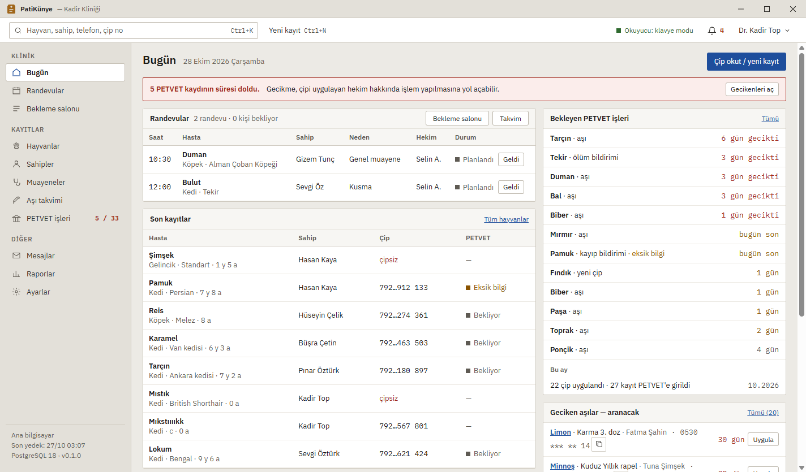

Kedi ve köpeklere mikroçip zorunlu hale gelince kliniklerde aynı bilgi iki kere girilmeye başlandı: bir kere klinik programına, bir kere PETVET'e. PatiKünye bu iki işi tek ekranda toplamak için yazıldı. Çip okutulur, hayvan ve sahibi bulunur ya da birkaç alanla kaydedilir; PETVET'e girilmesi gereken her şey 15 günlük süresiyle birlikte iş listesine düşer.

Program internet gerektirmez. Veritabanı (PostgreSQL 18) programla birlikte gelir, ayrıca bir şey kurmanız gerekmez.

## İçindekiler

- [Kurulum](#kurulum)
- [İlk açılış](#ilk-açılış)
- [Ekranlar](#ekranlar)
- [Özellikler](#özellikler)
- [Veriler nerede durur?](#veriler-nerede-durur)
- [Geliştirme](#geliştirme)
- [Bilinen eksikler](#bilinen-eksikler)

## Kurulum

**Gereken:** Windows 10 veya 11 (64 bit), yaklaşık 500 MB boş alan. USB barkod/çip okuyucu varsa takılı olsun, yoksa çip numarası elle de yazılabilir.

1. [Releases](https://github.com/Kadirify/patikunye/releases/latest) sayfasından `PatiKunye-Kurulum-0.1.0.exe` dosyasını indirin.
2. Dosyayı çalıştırın. Kurulum dosyası henüz imzalı olmadığı için Windows **"Windows bilgisayarınızı korudu"** uyarısı verebilir. **Ek bilgi → Yine de çalıştır** ile devam edin.
3. Programın kimler için kurulacağını seçin. Tek bilgisayarlı klinikte **Sadece benim için** yeterli; aynı bilgisayarı farklı Windows kullanıcıları kullanıyorsa diğerini seçin.

   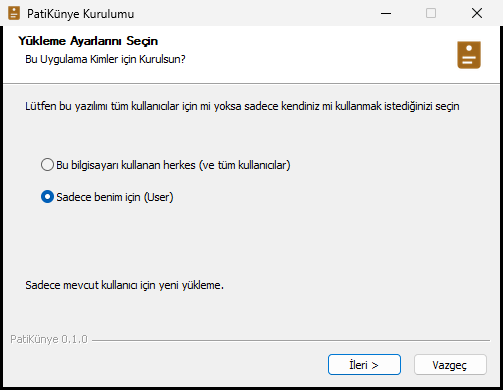

4. Kurulum klasörünü onaylayın (değiştirmeniz gerekmez) ve **Kur**'a basın. Kurulum bitince masaüstüne PatiKünye kısayolu gelir.

   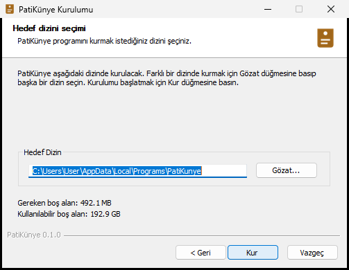

Kaldırmak için: **Ayarlar → Uygulamalar → PatiKünye → Kaldır**. Kaldırma klinik verilerini silmez; veri klasörü yerinde kalır.

## İlk açılış

Program ilk açıldığında kurulum sihirbazı çıkar. 10 adım var, çoğu birkaç saniye sürer.

| | |
|---|---|
| 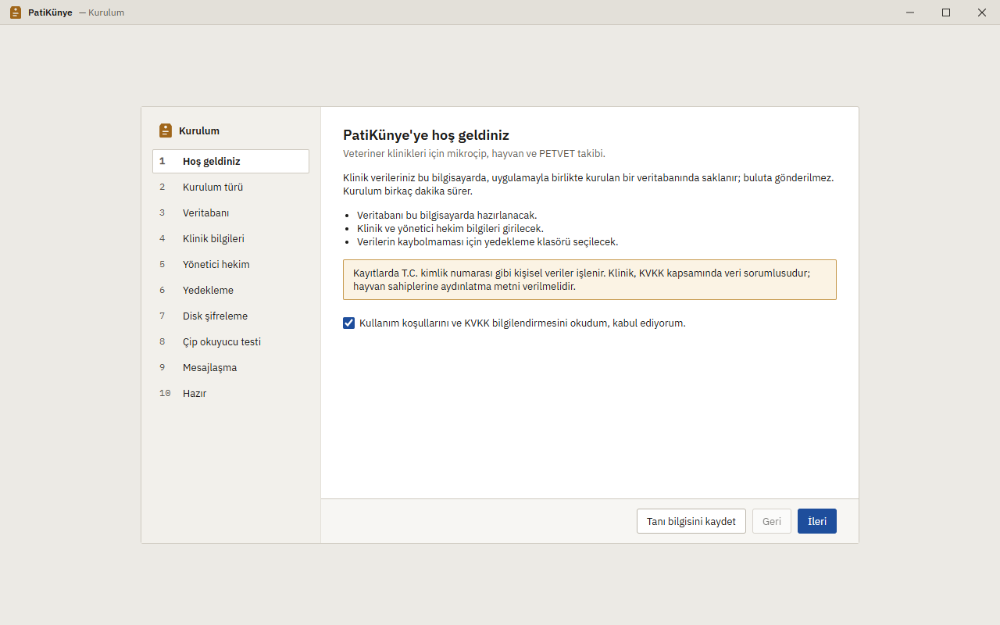 | **1. Hoş geldiniz.** Verilerin buluta gönderilmediği, bu bilgisayarda tutulduğu ve KVKK açısından veri sorumlusunun klinik olduğu anlatılır. Kutuyu işaretleyip devam edin. |
| 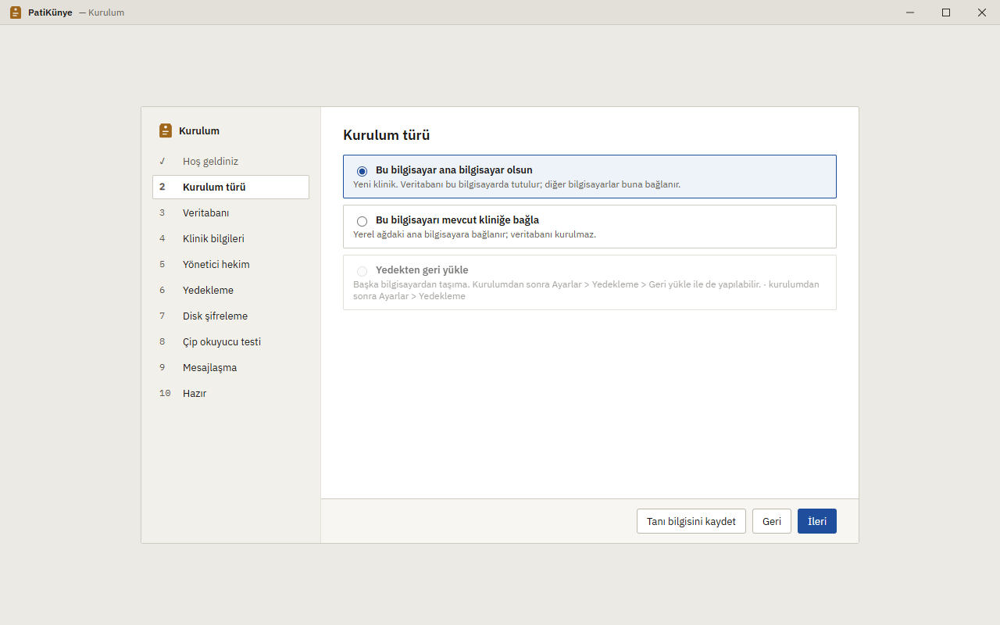 | **2. Kurulum türü.** İlk bilgisayarda **Bu bilgisayar ana bilgisayar olsun** seçilir; veritabanı bu bilgisayarda kurulur. Klinikte ikinci bir bilgisayar varsa onda **Bu bilgisayarı mevcut kliniğe bağla** seçilir; ana bilgisayardaki eşleştirme koduyla bağlanır, veritabanı kurulmaz. |
| 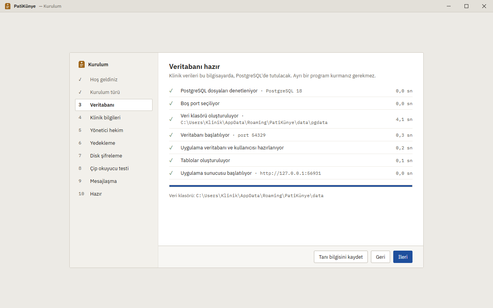 | **3. Veritabanı.** PostgreSQL kendi kendine kurulur ve başlatılır. Her adımın ne kadar sürdüğü görünür; bir şey ters giderse **Tanı bilgisini kaydet** ile bir dosya alıp bana gönderebilirsiniz. |
| 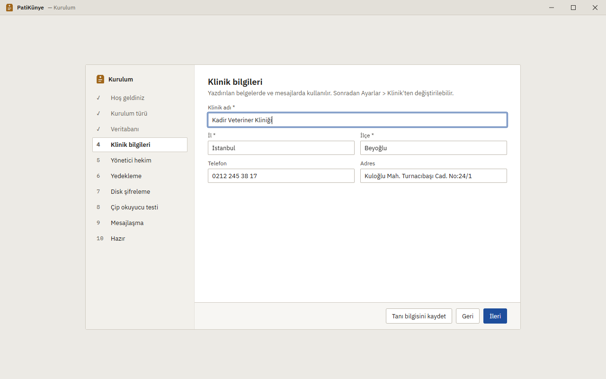 | **4. Klinik bilgileri.** Klinik adı, il, ilçe, telefon ve adres. Bunlar aşı karnesi, çip kartı ve reçete çıktılarının başlığında kullanılır. |
| 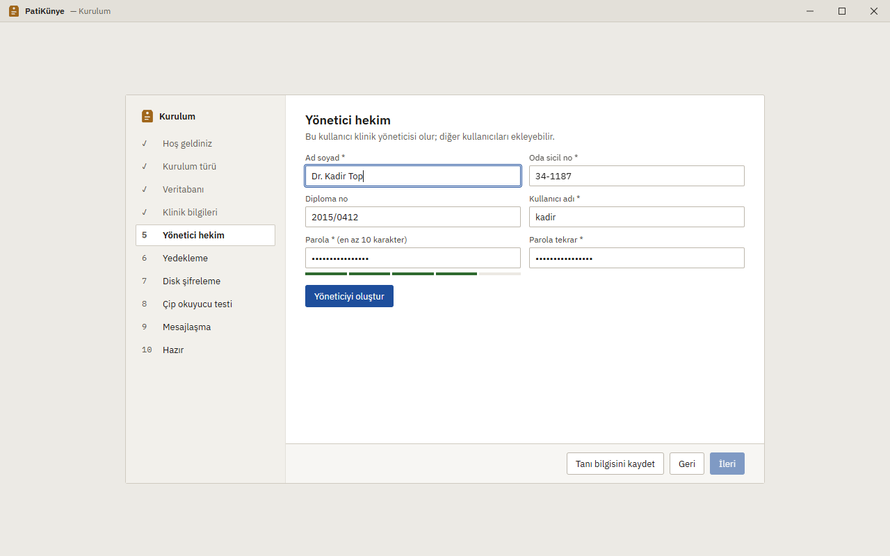 | **5. Yönetici hekim.** Klinik yöneticisi olacak hekimin adı, oda sicil numarası, kullanıcı adı ve parolası (en az 10 karakter). Diğer hekim ve personel daha sonra Ayarlar'dan eklenir. |
| 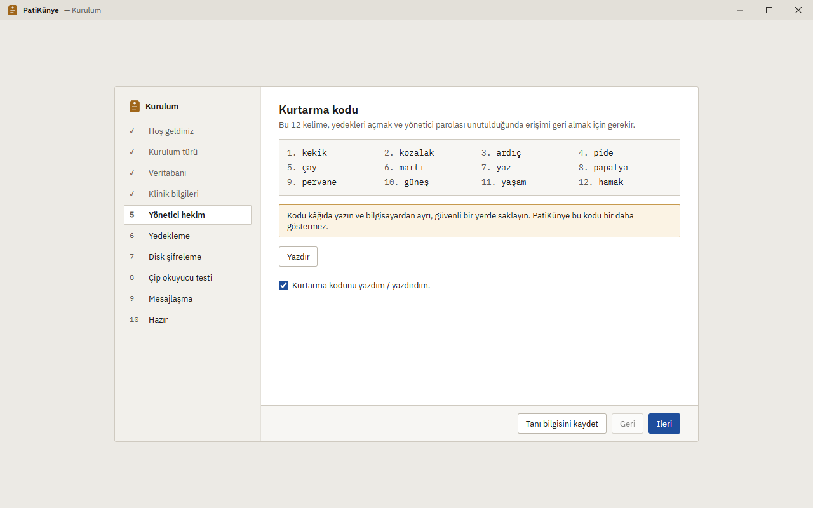 | **Kurtarma kodu.** 12 kelimelik kod bir kez gösterilir. Kâğıda yazın ya da yazdırın, bilgisayardan ayrı bir yerde saklayın. Yedekleri başka bilgisayarda açmak ve yönetici parolası unutulduğunda girmek için bu kod gerekir. |
| 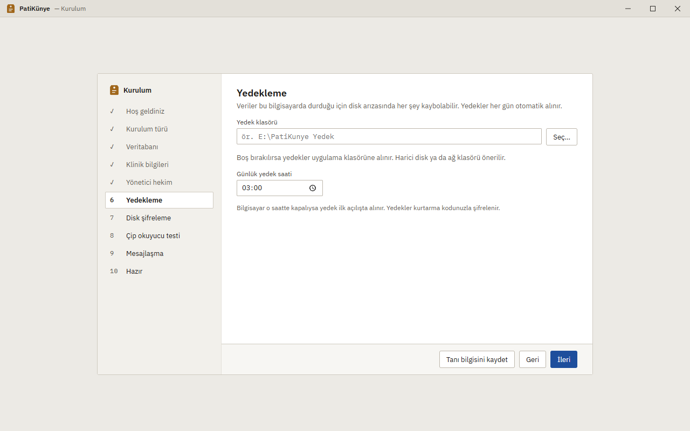 | **6. Yedekleme.** Günlük yedeğin gideceği klasör ve saat. Harici disk ya da ağ klasörü seçmenizi öneririm; boş bırakılırsa yedek aynı diske alınır, disk bozulursa yedek de gider. |
| 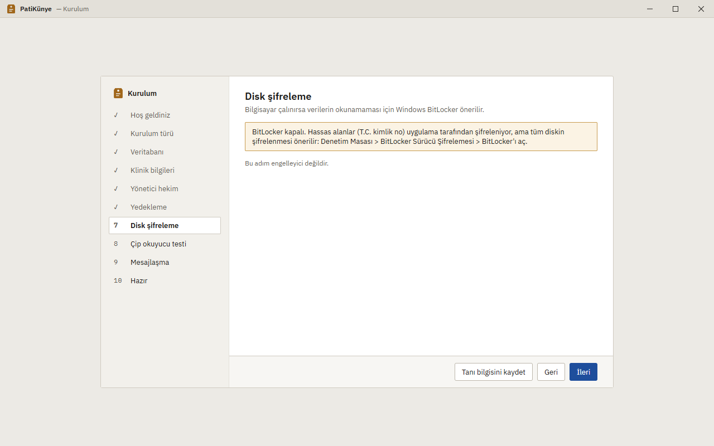 | **7. Disk şifreleme.** BitLocker açık mı diye bakılır. Kapalıysa nereden açılacağı yazılır. Zorunlu değil, ama bilgisayar çalınırsa verilerin okunamaması için özellikle dizüstünde açmanızı öneririm. |
| 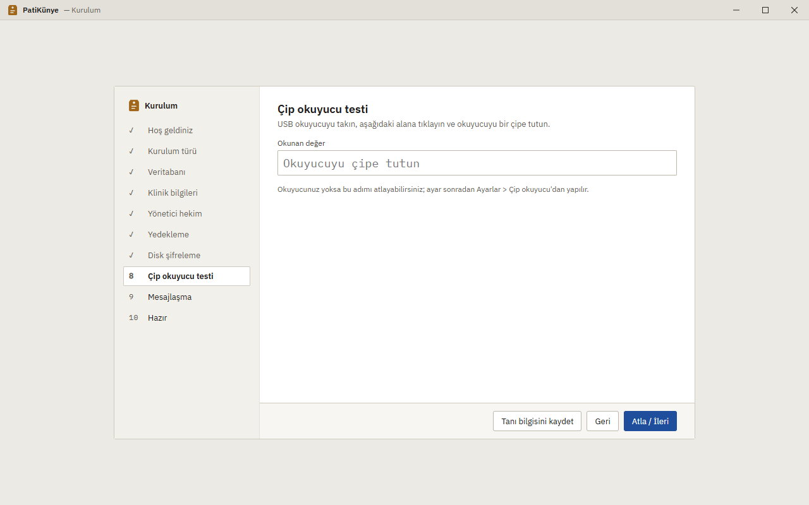 | **8. Çip okuyucu testi.** USB okuyucuyla bir çip okutun; program okuyucunun hızını ölçer ve klavyeden yazılanla okuyucudan geleni ayırt etmeyi öğrenir. Okuyucu yoksa atlanabilir. |
| 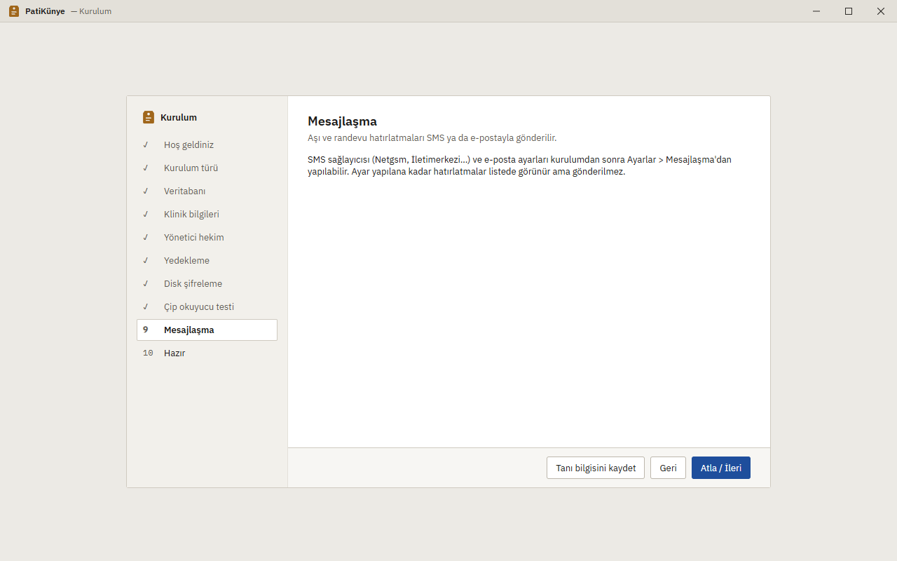 | **9. Mesajlaşma.** Aşı ve randevu hatırlatmalarının SMS ya da e-postayla gideceği anlatılır. Sağlayıcı (Netgsm, İletimerkezi) ve e-posta ayarları sonradan Ayarlar → Mesajlaşma'dan yapılır. |
| 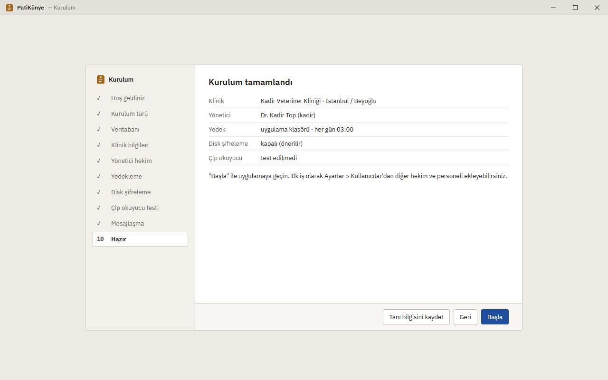 | **10. Hazır.** Özet gösterilir. **Başla** ile program açılır ve ilk yedek hemen alınır. |

## Ekranlar

Her ekranın ne işe yaradığı ve neler yapılabildiği [tanıtım sayfasında](docs/tanitim/index.html) tek tek anlatılıyor (36 ekran). Birkaçı:

**Hızlı kayıt.** Çip okutulunca açılır. Çip numarası doğrulanır, sahip aranır ya da yeni sahip girilir, hayvan birkaç alanla kaydedilir ve PETVET görevi kendiliğinden açılır.

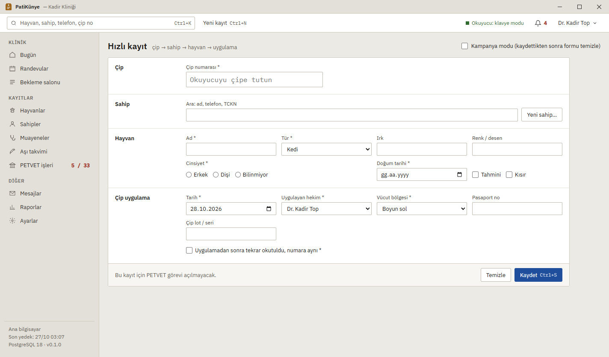

**Hayvan kartı.** Kimlik, çip geçmişi, aşılar, muayeneler, randevular ve sahip geçmişi sekmeler halinde aynı yerde.

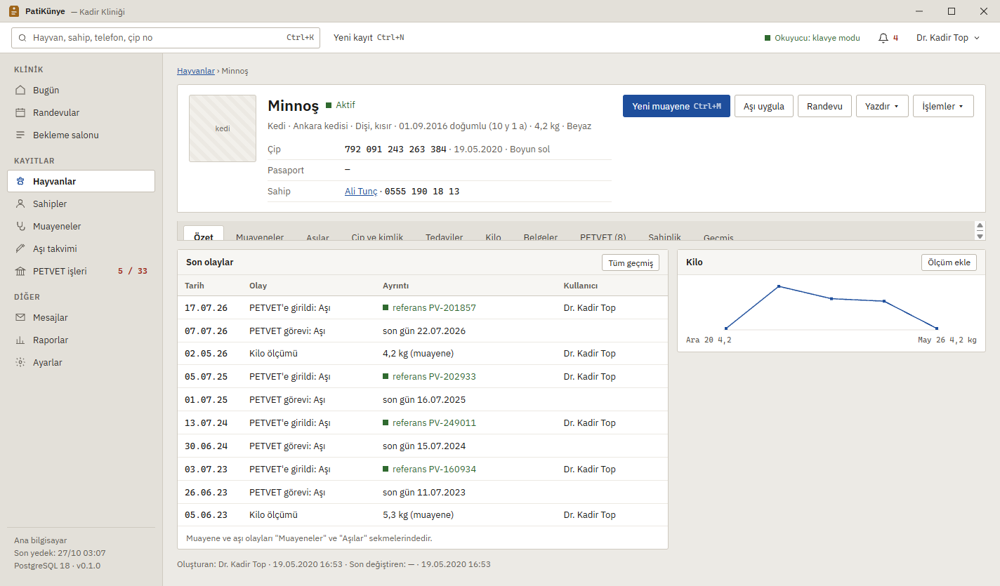

**PETVET işleri.** PETVET'e girilmesi gereken her olay (çip uygulama, kuduz aşısı, ölüm, sahip değişikliği) süresiyle birlikte listelenir. Görev açılınca TARBİL'e yazılacak alanlar kopyalanmaya hazır gelir.

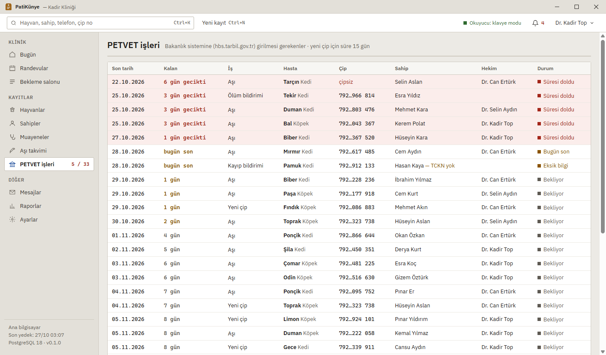

**Muayene.** SOAP düzeninde muayene, yaşam bulguları, tanı, tedavi satırları. Kaydedilen muayene imzalanır; imzadan sonra değişiklik ancak ek sürümle yapılır.

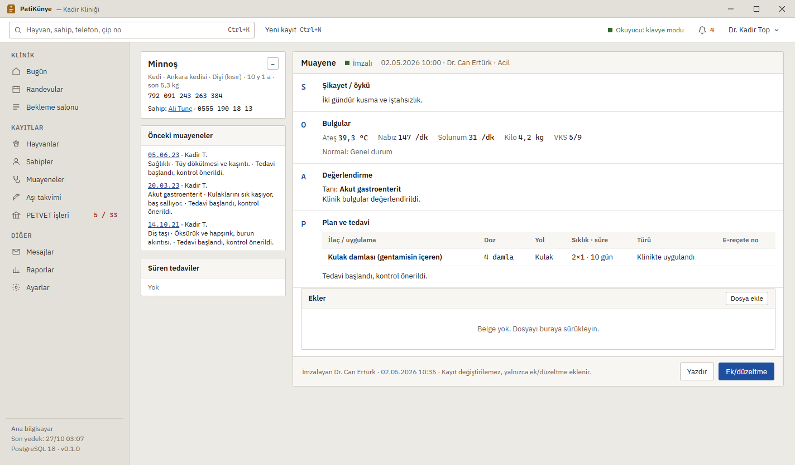

**Randevular.** Hekim sütunlu gün görünümü, sürükle-bırak ile taşıma, gelen hastalar için bekleme salonu.

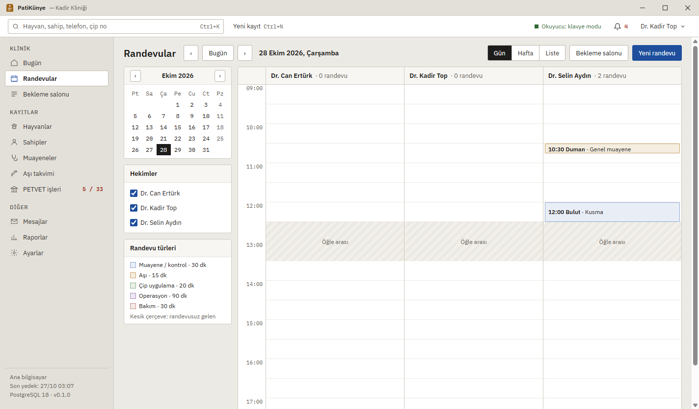

**Yedekleme.** Şifreli günlük yedek, yedeğin açılıp açılmadığının denetlenmesi, başka bilgisayara geri yükleme.

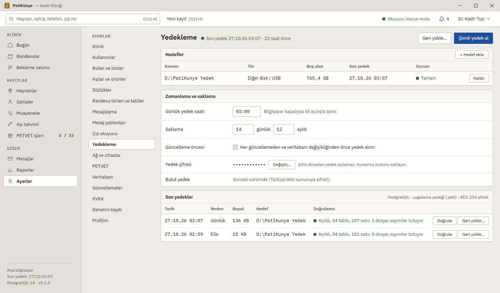

**Çıktılar.** Aşı karnesi, barkodlu kayıt/çip kartı, muayene özeti ve tedavi talimatı yazdırılır.

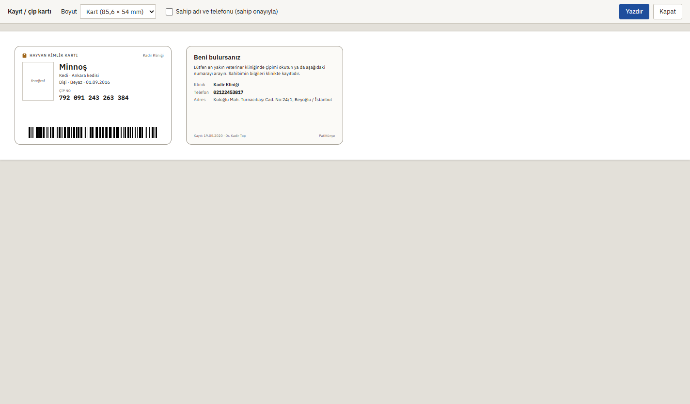 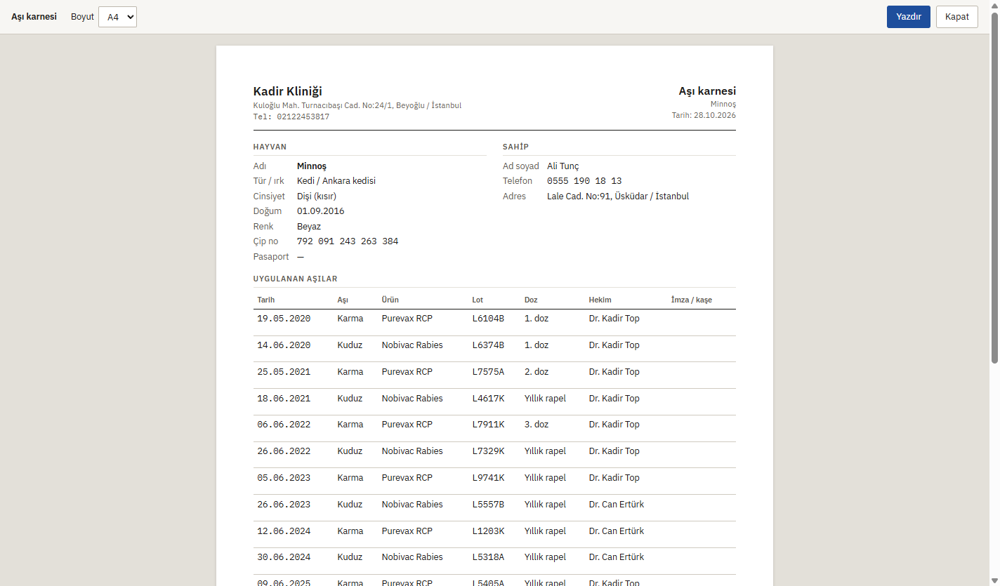

## Özellikler

| Bölüm | Neler var |
|---|---|
| Çip ve kayıt | USB okuyucuyla her ekrandan çip yakalama, çip doğrulama, hızlı kayıt, kampanya günleri için seri kayıt |
| Sahipler ve hayvanlar | Sahip/hayvan kartları, mükerrer sahip birleştirme, ölüm, kayıp, bulundu ve sahip değişikliği işlemleri |
| Muayene | SOAP, otomatik taslak, imza ve ek sürümler, tedavi satırları, alerji uyarısı, kilo takibi |
| Aşılar | Aşı uygulama, protokoller, aşı takvimi, kuduz aşısında PETVET görevi |
| PETVET | 15 gün kuralına göre iş listesi, TARBİL'e kopyalanacak alanlar, eksik TCKN takibi |
| Randevu | Hekim sütunlu takvim, sürükle-bırak, bekleme salonu, randevu türleri ve tatil günleri |
| Mesajlar | Aşı ve randevu hatırlatmaları (SMS: Netgsm, İletimerkezi; e-posta), şablonlar, sessiz saatler |
| Yönetim | Kullanıcılar ve roller, PIN ile hızlı giriş, kilit ekranı, KVKK talepleri ve anonimleştirme, değiştirilemez denetim kaydı |
| Yedekleme | Kurtarma koduyla şifreli günlük yedek, doğrulama, başka bilgisayara geri yükleme |
| Raporlar | 9 rapor ve CSV dışa aktarma, aşı karnesi, çip kartı, muayene özeti, onam formu |
| Yerel ağ | Klinikteki diğer bilgisayarlar ana bilgisayara eşleştirme koduyla bağlanır |

## Veriler nerede durur?

| | Klasör |
|---|---|
| Veritabanı ve ayarlar | `%APPDATA%\PatiKünye\data` |
| Yedekler | Kurulumda seçilen klasör (varsayılan: veri klasörünün altı) |

- Veritabanı yalnızca bu bilgisayardan erişilebilir (`127.0.0.1`). Ağdaki diğer bilgisayarlar veritabanına değil, programın kendi sunucusuna HTTPS ile bağlanır.
- TCKN gibi hassas alanlar veritabanında şifreli tutulur. Şifreleme anahtarları Windows'un kullanıcıya özel korumasıyla saklanır.
- Yedekler kurtarma koduyla şifrelenir; kod olmadan açılamaz.

## Geliştirme

Node.js 22 gerekir.

```bash
npm install
npm run dev          # Electron, ilk açılışta kurulum sihirbazı
```

Arayüz üzerinde tarayıcıdan çalışmak için iki terminal:

```bash
npm run dev:server   # veritabanı (.dev-data) + API, port 47800
npm run dev:web      # arayüz, http://localhost:5173
```

```bash
npm test             # 196 test, her dosya kendi geçici PostgreSQL'ini kurar
npm run typecheck
npm run dist         # kurulum dosyası: dist/PatiKunye-Kurulum-<sürüm>.exe
```

Örnek veri basmak için (geliştirme veritabanına):

```bash
npx tsx scripts/seed-demo.ts --dev
npx tsx scripts/seed-history.ts --dev
```

Kullanılanlar: Electron, React, Fastify, Drizzle ORM, PostgreSQL 18 (embedded-postgres), electron-builder.

## Bilinen eksikler

- Kurulum dosyası imzasız, Windows ilk çalıştırmada uyarı veriyor.
- PostgreSQL Windows servisi olarak değil, programın alt süreci olarak çalışıyor; program sistem tepsisinde açık kaldığı sürece veritabanı da açık.
- Güncelleme sunucusu henüz yok.
- SMS sağlayıcıları gerçek hesapla denenmedi.
- Aşı protokolleri, tanı listesi ve KVKK metinleri örnek olarak konuldu; kullanmadan önce kendi kliniğinize göre düzenleyin.

Hata bulursanız ya da öneriniz varsa Issues'a yazabilirsiniz.
